# Synap

    

Synap is a lightweight, end-to-end Retrieval-Augmented Generation (RAG) project designed to help you understand how document-based question answering is built from first principles. It ingests PDF documents, chunks them into semantically useful segments, embeds them into a vector space, retrieves the most relevant content for a user query, and sends the result to a large language model for grounded answers.

The project is intentionally code-first and educational: it strips the stack down to the core components that make RAG systems work while still being practical enough to use in a real workflow.

### End-to-End Pipeline

```mermaid
graph LR
    subgraph Ingestion["1. Document ingestion and indexing"]
        UIUpload["Upload one or more PDFs in Streamlit"] --> NewFiles{"Any new filenames in this session?"}
        NewFiles -->|Yes| SavePDF["Save uploaded PDFs to data/docs/"]
        SavePDF --> ScanPDF["Scan all PDFs in data/docs/"]
        ScanPDF --> Extract["Extract page text and add filename separators"]
        Extract --> FullText["Write combined text to knowledge_base.txt"]
        FullText --> Split["Split into consecutive 500-character chunks"]
        Split --> Chunks["Write chunks to chunks.json"]
        Chunks --> EmbedDocs["Cohere embed-english-light-v3.0 embeds each chunk"]
        EmbedDocs --> StoreVectors["Write vectors to embeddings/knowledge_base.json"]
        NewFiles -->|No| SkipIndex["Skip indexing; keep existing artifacts"]
    end

    subgraph QuestionAnswering["2. Question answering"]
        Question["User submits a question"] --> LoadData["Load chunks.json and knowledge_base.json"]
        LoadData --> EmbedQuery["Cohere embeds the question"]
        EmbedQuery --> Compare["Compute dot-product score against each chunk vector"]
        Compare --> Rank["Sort by score and select top 5 chunks"]
        Rank --> BuildPrompt["Combine question with retrieved chunks"]
        HistoryFile["Load prior turns from chat_history.json"] --> HistoryContext["Build system instructions, JSON schema, and conversation history"]
        HistoryContext --> AddTurn["Append current question to conversation"]
        BuildPrompt --> AddTurn
        AddTurn --> Groq["Groq chat model generates a grounded response"]
        Groq --> Parse["Parse JSON: main_explanation and summary"]
        Parse --> SaveTurn["Append summary to conversation history"]
        SaveTurn --> Display["Stream main_explanation in Streamlit"]
        SaveTurn --> PersistHistory["Save conversation to data/artifacts/chat_history.json"]
    end

    StoreVectors -. "available for questions" .-> LoadData
    Chunks -. "available for questions" .-> LoadData
```



Indexing runs when at least one newly uploaded filename is detected. Each run scans all PDFs in `data/docs/` and rewrites the combined text, chunks, and embeddings. At question time, chunks and vectors are loaded from disk in matching order; the retriever uses dot-product scores and returns up to five chunks. The chat model is instructed to ground its answer in those chunks, and its JSON response contains the displayed explanation and a summary stored in conversation history.

### Architecture

The project follows a modular pipeline structure, with responsibilities separated by task and domain.

```text
src/
├── app/
│   └── app.py                  # Streamlit UI entry point
├── components/
│   ├── __init__.py
│   ├── memory.py               # Conversation history helpers
│   ├── models.py               # LLM and embedding model setup
│   ├── parsers.py              # Output schema parser
│   ├── retrievar.py            # Semantic retrieval logic
│   └── templates.py            # Prompt templates and grounding instructions
├── rag_from_scratch/
│   ├── __init__.py
│   └── main.py                 # Runnable orchestration for the RAG chain
├── tasks/
│   ├── __init__.py
│   ├── document_loading.py     # PDF loading and knowledge base creation
│   ├── embedding.py            # Embedding generation and persistence
│   └── text_splitting.py       # Chunking logic
└── __init__.py

data/
├── docs/                       # Uploaded PDF documents
├── artifacts/
│   ├── chat_history.json
│   ├── chunks.json
│   └── knowledge_base.txt
└── embeddings/
    └── knowledge_base.json
```